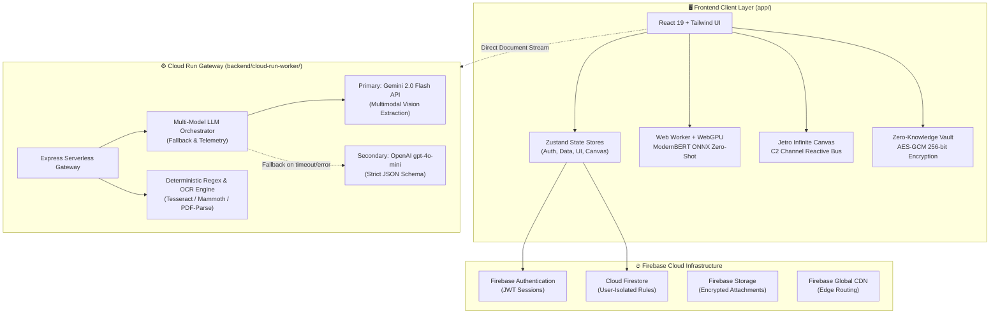
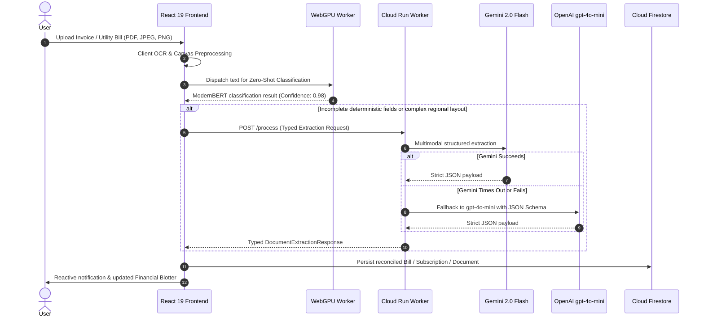

# Arcora Platform — Enterprise AI Life Administration & Document Intelligence OS

<div align="center">

[](https://react.dev/)
[](https://www.typescriptlang.org/)
[](https://www.w3.org/TR/webgpu/)
[](https://firebase.google.com/)
[](https://ai.google.dev/)
[](https://openai.com/)
[](https://tailwindcss.com/)
[](https://vitejs.dev/)

<p align="center">
  <strong>Next-Generation Personal Life OS with WebGPU-Accelerated Zero-Shot Document Classification, Reactive Spatial Infinite Canvas, and Cascading Multi-Model LLM Orchestration.</strong>
</p>

</div>

---

## 🏛️ Executive Summary

**Arcora** is an enterprise-grade personal life administration platform and intelligent document management ecosystem. Built on a modular monorepo architecture, Arcora synthesizes local, on-device neural acceleration (WebGPU + ModernBERT ONNX) with resilient cloud serverless backends (Google Cloud Run + Firebase) and multimodal LLMs (Gemini 2.0 Flash & OpenAI `gpt-4o-mini`).

It empowers individuals and executive households to automatically ingest, classify, parse, and reconcile bills, invoices, subscriptions, warranties, identity documents, and passwords into a unified, zero-knowledge reactive cockpit.

---

## 📐 System Architecture

### 1. High-Level Topology



---

### 2. Cascading 3-Tier Intelligent Document Processing (IDP) Pipeline



---

### 3. Spatial Infinite Canvas & Jetro C2 Reactive Wire Architecture

The Infinite Canvas provides a spatial operating environment where components communicate across named channels through reactive wires:

```
┌─────────────────────────────────────────────────────────────────────────────┐
│                           JETRO INFINITE CANVAS                             │
│                                                                             │
│   ┌──────────────────────┐                     ┌────────────────────────┐   │
│   │ Document Frame Node  │                     │ Financial Blotter Node │   │
│   │ [Tesseract + ONNX]   │                     │ [Liabilities & Bills]  │   │
│   │                      │  Channel: doc_feed  │                        │   │
│   │ (Port: out-docs) ────┼────────────────────►│ (Port: in-bills)       │   │
│   └──────────────────────┘   Bezier Wire (C2)  │ (Port: out-expenses)   │   │
│                                                └──────────┬─────────────┘   │
│                                                           │                 │
│                                    Channel: fin_metrics   │ Bezier Wire (C2)│
│                                                           ▼                 │
│   ┌──────────────────────┐                     ┌────────────────────────┐   │
│   │ Multi-LLM Copilot    │                     │ Predictive Horizon     │   │
│   │ [Gemini + OpenAI]    │                     │ [90-Day Runway Chart]  │   │
│   │ (Port: in-chat-ctx)  │                     │ (Port: in-metrics)     │   │
│   └──────────────────────┘                     └────────────────────────┘   │
│                                                                             │
│   [WebGPU Layout Compute]: WGSL N-Body Repulsive Shader (CPU Verlet Fallback)│
└─────────────────────────────────────────────────────────────────────────────┘
```

---

## ⚡ Core Architectural Pillars

### 1. 🧠 Intelligent Document Processing (IDP)
- **Local Neural Acceleration**: Zero-shot document classification runs directly inside the client browser via `@huggingface/transformers` using ONNX runtime and WebGPU acceleration, with automatic fallback to WASM/CPU.
- **Cascading Multi-Model Orchestration**: Background worker prioritizes Google Gemini 2.0 Flash for low-latency multimodal document comprehension, backed by OpenAI `gpt-4o-mini` with strict JSON schemas.
- **Regional Parser Heuristics**: Pre-tuned heuristics for regional utility providers (e.g. FESCO, K-Electric, PTCL, SNGPL) ensuring sub-100ms deterministic extraction before cloud escalation.

### 2. 📊 Autonomous Financial Ledger & Blotter
- **Bill & Subscription Tracking**: Automated due date calculation, payment status monitoring, recurring cadence tracking, and penalty avoidance.
- **Predictive Cashflow Horizon**: Dynamic runway calculations and expense forecasting.
- **Push Notification Engine**: Cloud Run scheduled cron jobs (`/jobs/send-push-reminders`) dispatching Web Push VAPID reminders with single-use security tokens.

### 3. 🌌 Spatial Infinite Canvas
- **Rendering Layer**: Modular canvas supporting 60 FPS viewport transformation, infinite pan, smooth wheel/pinch zoom, and dynamic grid scaling.
- **Reactive C2 Protocol**: Frame decomposition inspired by Jetro C2 command-and-control cockpits, allowing cards to exchange events via typed named channels (`__JET` message bus).
- **WebGPU Physics Engine**: WGSL compute shader executing parallel pairwise N-body repulsion and spring attraction for automated spatial graph layouts.

### 4. 🔐 Enterprise Security & Zero-Knowledge Vault
- **Client-Side Cryptography**: Password entries are encrypted client-side using AES-GCM 256-bit keys derived with PBKDF2 before ever touching Firestore.
- **Zero Raw Error Leakage**: All API responses pass through typed validation models (`Result<T, E>`) preventing raw stack traces from reaching client interfaces.
- **Secret Quarantine**: Strict `.gitignore` policy isolating environment secrets, service account credentials, and IDE cache dumps.

---

## 📂 Repository Structure

```
Life Os - Full Stack App/
├── package.json                    # Root npm workspaces configuration
├── .env.example                    # Master environment variables template
├── .gitignore                      # Enterprise quarantine rules
├── firebase.json                   # Firebase Hosting and security configuration
├── .firebaserc                     # Firebase project binding
│
├── app/                            # React 19 Frontend Web Application
│   ├── src/
│   │   ├── components/
│   │   │   ├── canvas/             # Infinite Canvas (Grid, Nodes, Edges, Toolbar, Minimap)
│   │   │   ├── bills/              # Financial bill tracking views
│   │   │   ├── subscriptions/      # Subscription management views
│   │   │   ├── warranties/         # Warranty card organizer
│   │   │   ├── documents/          # Document vault and upload dialogs
│   │   │   ├── passwords/          # Client-encrypted credential vault
│   │   │   ├── dashboard/          # Central telemetry cockpit
│   │   │   └── layout/             # Atmosphere, Sidebar, Header shells
│   │   ├── modules/
│   │   │   └── canvas/webgpu/      # WGSL compute shader layout engine
│   │   ├── services/
│   │   │   ├── extractionService.ts# Typed document extraction client
│   │   │   └── classifier.worker.ts# WebGPU ONNX zero-shot classifier worker
│   │   └── store/                  # Zustand state stores (canvas, auth, data, ui)
│   ├── vite.config.ts              # Vite 7 build config with chunk optimization
│   └── tsconfig.json               # TypeScript app compiler configuration
│
├── backend/
│   └── cloud-run-worker/           # Serverless Express Extraction Worker
│       ├── src/
│       │   ├── ai/
│       │   │   ├── modelOrchestrator.ts # Cascading Gemini/OpenAI orchestrator
│       │   │   ├── geminiExtractor.ts   # Gemini Flash multimodal extractor
│       │   │   └── openaiExtractor.ts   # OpenAI structured outputs extractor
│       │   ├── jobs/               # Background processing and push cron jobs
│       │   └── parsers/            # PDF, DOCX, and Tesseract OCR extractors
│       └── Dockerfile              # Production container build
│
├── packages/
│   └── shared/                     # Shared Monorepo Package (@arcora/shared)
│       ├── src/
│       │   ├── types/              # Universal domain, canvas, and extraction types
│       │   ├── schemas/            # Zod validation schemas (financial, canvas, extraction)
│       │   └── validation/         # Typed Result<T, E> defensive recovery helpers
│       └── tsconfig.json           # Self-contained compiler configuration
│
└── docs/                           # Centralized Technical Documentation
    ├── architecture/               # System specifications, design tokens, security
    └── research/                   # Pakistani regional bills & reference ground truth
```

---

## 🚀 Quickstart & Local Development

### 1. Prerequisites
- **Node.js**: `v20.x` or `v22.x`
- **npm**: `v10.x` or higher
- **Docker** (optional, for containerized backend execution)

### 2. Environment Setup
Clone the repository and initialize the environment templates:

```bash
# Copy root environment template
cp .env.example .env

# Configure frontend environment
cp app/.env.example app/.env

# Configure backend environment
cp backend/cloud-run-worker/.env.example backend/cloud-run-worker/.env
```

Populate `app/.env` with your Firebase credentials and `backend/cloud-run-worker/.env` with your Gemini/OpenAI API keys.

### 3. Build & Compile All Workspaces

```bash
# Build shared contracts
cd packages/shared
npm run build

# Build and verify frontend
cd ../../app
npm run build

# Build and verify backend
cd ../backend/cloud-run-worker
npm run build
```

### 4. Running Development Servers

```bash
# Terminal 1: Start Frontend Dev Server (port 3000)
cd app
npm run dev

# Terminal 2: Start Backend Cloud Run Worker (port 8080)
cd backend/cloud-run-worker
npm run dev
```

Visit `http://localhost:3000` to launch the Arcora workspace. Navigate to `/canvas` to explore the WebGPU-accelerated Infinite Canvas.

---

## ☁️ Production Deployment

### Frontend (Firebase Hosting)

```bash
# Authenticate and select project
firebase login
firebase use arcora-cd7d0

# Build frontend bundle
cd app
npm run build

# Deploy Hosting & Firestore Security Rules
cd ..
firebase deploy --only hosting,firestore:rules,storage:rules
```

### Backend (Google Cloud Run)

```bash
cd backend/cloud-run-worker

# Build and deploy container image to Google Cloud Run
gcloud builds submit --tag gcr.io/arcora-cd7d0/extraction-worker
gcloud run deploy extraction-worker \
  --image gcr.io/arcora-cd7d0/extraction-worker \
  --platform managed \
  --region us-central1 \
  --allow-unauthenticated \
  --set-env-vars FIREBASE_PROJECT_ID=arcora-cd7d0,PUSH_LINK_BASE_URL=https://arcora-cd7d0.web.app
```

---

## 🛡️ License

Confidential and proprietary. Designed and maintained by Arcora Engineering.
